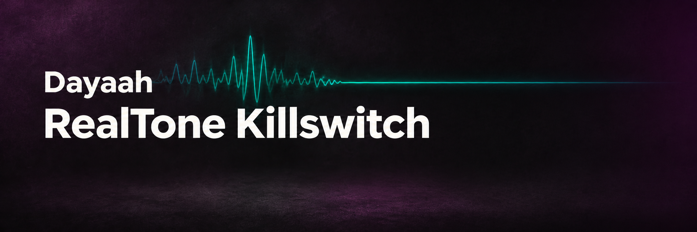

<p align="right"><strong>Español</strong> · <a href="README.md">English</a></p>

<p align="center">
  
</p>

<p align="center">
  Killswitch por software para guitarra, micrófonos y otras entradas de audio en Windows. Mantén presionada una tecla para silenciar la entrada y suéltala para recuperar el audio.
</p>

<p align="center">
  
  
  
  
</p>

<p align="center">
  <a href="https://github.com/dayitaah/Dayaah-RealTone-Killswitch/releases/latest"><strong>Descargar para Windows x64</strong></a> ·
  <a href="CHANGELOG.md">Historial de cambios</a>
</p>

Dayaah RealTone Killswitch convierte cualquier tecla en un interruptor
momentáneo para el Rocksmith Real Tone Cable. Al mantenerla presionada aplica el
**Mute** real del dispositivo de audio de Windows; al soltarla restaura
exactamente el estado anterior.

No perfora, recablea ni modifica la guitarra XD. Tampoco cambia el nivel de
entrada que Rocksmith dejó durante la calibración.

## Características

- Acción momentánea: mantener para silenciar y soltar para restaurar.
- Usa el Mute real del dispositivo, no una reducción de ganancia al mínimo.
- Conserva intacto el nivel calibrado (por ejemplo, 44).
- Hotkey configurable; `Barra espaciadora` de forma predeterminada en instalaciones nuevas.
- Modo Rocksmith activado de forma predeterminada: la hotkey elegida solo actúa
  cuando `Rocksmith2014.exe` está al frente y no llega al juego. Space es solo
  el valor inicial; si eliges otra tecla, Space vuelve a funcionar normalmente.
- Modo global opcional para conservar el funcionamiento anterior sin bloquear
  la tecla en otras aplicaciones.
- Detecta automáticamente el Real Tone Cable oficial cuando es posible.
- Selector manual para cualquier entrada de grabación activa de Windows.
- Funciona discretamente desde el área de notificación.
- Botones integrados para GitHub y Ko-fi.
- Sin cable de audio virtual, driver propio, instalador, cuenta ni permisos de
  administrador.
- Sin telemetría, análisis, publicidad ni tráfico automático de red.

## Descargar y usar

1. Abre la [versión más reciente](https://github.com/dayitaah/Dayaah-RealTone-Killswitch/releases/latest).
2. Descarga el ZIP para Windows x64 y extráelo.
3. Conecta el Real Tone Cable.
4. Ejecuta `Dayaah_RealTone_Killswitch.exe`.
5. Confirma el cable en el selector y cambia la hotkey si quieres.
6. Oculta la aplicación en el área de notificación y abre Rocksmith.

SmartScreen puede mostrar una advertencia de editor desconocido porque las
compilaciones comunitarias no tienen una firma digital comercial. El código
fuente y el flujo de compilación de GitHub Actions están disponibles para revisión.

**¿Actualizas desde v1.2.0?** Se conserva tu hotkey guardada. Si el INI antiguo
no especifica una tecla, se mantiene AltGr. El Modo Rocksmith se activa al
actualizar desde v1.2.0. Desactívalo si quieres mutear desde otras aplicaciones.

## Cómo funciona

```text
Tecla seleccionada presionada
  -> evento global de teclado
  -> recuerda el estado Mute anterior
  -> IAudioEndpointVolume::SetMute(TRUE)

Tecla seleccionada liberada
  -> restaura el estado Mute anterior
```

La aplicación nunca deshabilita ni reconecta el dispositivo, así que Rocksmith
mantiene abierto su flujo de entrada. Un seguro también restaura el estado si
Windows pierde el evento de liberación de la tecla.

En Modo Rocksmith, el hook de teclado consume la hotkey mientras el juego está
al frente. Si cambias de ventana con la tecla presionada, el audio se restaura
de inmediato y la liberación pendiente también se consume para evitar entregar
medio evento a otra aplicación.

El hook corre en un hilo dedicado y solo bloquea la hotkey seleccionada. Un
watchdog libera el Mute si una pulsación bloqueada dura 30 segundos, y un
marcador de recuperación restaura el estado anterior si la aplicación se cierra
de forma forzada durante un corte.

Si el cable se desconecta o Windows invalida su endpoint, la aplicación intenta
abrir de nuevo el dispositivo seleccionado cada tres segundos al detectar el
problema. La hotkey vuelve a estar disponible al reconectarse.

El tiempo real de respuesta depende del driver y del búfer de audio de
Rocksmith.

## Compatibilidad

- Windows 10/11 x64.
- Diseñado y probado con Rocksmith 2014 y el Rocksmith Real Tone Cable oficial.
- Otros dispositivos de grabación pueden seleccionarse manualmente si su
  driver expone Mute mediante Windows Core Audio.
- Rocksmith y el killswitch deben ejecutarse con el mismo nivel de permisos.

## Controles

| Control | Acción |
| --- | --- |
| Idioma | Cambiar entre español e inglés |
| Hotkey seleccionada | Mantener para silenciar; soltar para restaurar |
| Cambiar hotkey | Capturar una tecla nueva |
| Modo Rocksmith | Limitar la hotkey al juego y bloquearla antes de que Rocksmith la reciba |
| Actualizar | Volver a enumerar los dispositivos de grabación |
| Minimizar | Ocultar en el área de notificación |
| Doble clic en el icono | Restaurar la ventana |
| Clic derecho en el icono | Abrir o salir |

La aplicación inicia en español si ese es el idioma de pantalla de Windows y
en inglés en los demás casos. La selección se aplica al instante y queda
guardada para el próximo inicio.

## Compilar en Windows

### Visual Studio Build Tools

Instala Visual Studio 2022 Build Tools con **Desarrollo para el escritorio con
C++** y un Windows SDK. Abre **x64 Native Tools Command Prompt** y ejecuta:

```bat
build-msvc.bat
```

### MinGW-w64

Con `g++` y `windres` disponibles en `PATH`, ejecuta:

```bat
build-mingw.bat
```

Ambos scripts generan `Dayaah_RealTone_Killswitch.exe` en la raíz del
repositorio.

## Privacidad y seguridad

La aplicación guarda el idioma, la hotkey elegida, el estado del Modo Rocksmith,
el identificador del dispositivo de audio y, mientras existe un corte, el estado
necesario para recuperarlo en
`%APPDATA%\Dayaah\RealToneKillswitch.ini`. No realiza
peticiones de red en segundo plano. GitHub y Ko-fi se abren en el navegador
predeterminado solamente al pulsar sus botones.

Para reportar vulnerabilidades, consulta [SECURITY.md](SECURITY.md).

## Contribuir

Se aceptan reportes y mejoras en español o inglés. Lee
[CONTRIBUTING.md](CONTRIBUTING.md) antes de comenzar.

## Apoyar

Si esto salvó una guitarra nueva del taladro, puedes apoyar a Dayaah en Ko-fi:

<p>
  <a href="https://ko-fi.com/dayaah"></a>
</p>

## Licencia

Publicado bajo la [licencia MIT](LICENSE). Copyright © 2026 Dayaah.

Rocksmith y Real Tone Cable son marcas o productos de sus respectivos dueños.
Esta es una herramienta comunitaria independiente, sin afiliación ni respaldo
de Ubisoft.

