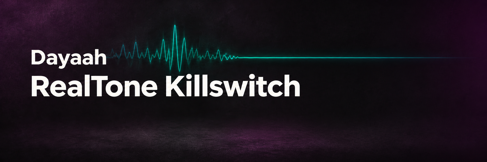

<p align="right"><a href="README.es.md">Español</a> · <strong>English</strong></p>

<p align="center">
  
</p>

<p align="center">
  A momentary software killswitch for the Rocksmith Real Tone Cable on Windows.
</p>

<p align="center">
  
  
  
  
</p>

<p align="center">
  <a href="https://github.com/dayitaah/Dayaah-RealTone-Killswitch/releases/latest"><strong>Download for Windows x64</strong></a> ·
  <a href="CHANGELOG.md">Changelog</a>
</p>

Dayaah RealTone Killswitch turns any keyboard key into a hold-to-kill switch for
the Rocksmith Real Tone Cable. Press the selected key to apply the Windows audio
endpoint's real **Mute** state; release it to restore the exact previous state.

It does not drill, rewire, or otherwise modify the guitar XD. It also leaves the
Rocksmith calibration/input level untouched.

## Features

- Momentary action: hold to mute, release to restore.
- Uses real endpoint Mute instead of reducing input gain to its minimum.
- Preserves the calibrated input level (for example, 44).
- Configurable keyboard hotkey; `Space` by default on new installations.
- Rocksmith Mode enabled by default: the selected hotkey only acts while
  `Rocksmith2014.exe` is in the foreground and is swallowed before the game
  receives it. Space is only the initial value; selecting another key restores
  normal Space behavior immediately.
- Optional global mode preserves the previous non-blocking behavior.
- Automatically detects the official Real Tone Cable when possible.
- Manual selector for any active Windows recording endpoint.
- Runs quietly in the notification area.
- Built-in GitHub and Ko-fi buttons.
- No virtual audio cable, custom driver, installer, account, or administrator
  permission required.
- No telemetry, analytics, advertising, or automatic network traffic.

## Download and use

1. Open the [latest release](https://github.com/dayitaah/Dayaah-RealTone-Killswitch/releases/latest).
2. Download the Windows x64 ZIP and extract it.
3. Connect the Real Tone Cable.
4. Run `Dayaah_RealTone_Killswitch.exe`.
5. Confirm the cable in the device selector and optionally choose another
   hotkey.
6. Hide the app to the notification area and start Rocksmith.

Windows SmartScreen may warn about an unknown publisher because community
builds are not commercially code-signed. The complete source and a GitHub Actions build workflow are included for
inspection.

**Updating from v1.2.0?** Your saved hotkey carries over. If the old INI did
not specify a hotkey, AltGr is preserved. Rocksmith Mode is enabled by default
when upgrading from v1.2.0. Turn it off to mute from other apps as before.

## How it works

```text
Selected key down
  -> global low-level keyboard event
  -> remember the endpoint's previous Mute state
  -> IAudioEndpointVolume::SetMute(TRUE)

Selected key up
  -> restore the previous Mute state
```

The application never disables or reconnects the recording device, so
Rocksmith keeps its active input stream. A small failsafe also restores the
state if Windows loses the key-up event.

In Rocksmith Mode, the keyboard hook consumes the selected hotkey while the
game is in the foreground. If focus changes while the key is held, audio is
restored immediately and the pending key-up is also consumed so another
application never receives half a keystroke.

The hook runs on a dedicated thread and only blocks the currently selected
hotkey. A watchdog releases Mute after a 30-second blocked hold, and a recovery
marker restores the previous state after a forced application exit.

If the cable is disconnected or Windows invalidates its endpoint, the
application retries the selected device every three seconds once it detects the
problem. The hotkey becomes available automatically when reconnection succeeds.

Actual response time depends on the device driver and Rocksmith's audio buffer.

## Compatibility

- Windows 10/11 x64.
- Designed and tested with Rocksmith 2014 and the official Rocksmith Real Tone
  Cable.
- Other recording devices can be selected manually when their drivers expose
  endpoint Mute through Windows Core Audio.
- Rocksmith and the killswitch must run at the same privilege level.

## Controls

| Control | Action |
| --- | --- |
| Selected hotkey | Hold to mute; release to restore |
| Change hotkey | Capture a new keyboard key |
| Rocksmith Mode | Limit the hotkey to the game and block it before Rocksmith receives it |
| Refresh | Re-enumerate recording devices |
| Minimize | Hide to the notification area |
| Tray icon double-click | Restore the window |
| Tray icon right-click | Open or exit |

## Build on Windows

### Visual Studio Build Tools

Install Visual Studio 2022 Build Tools with **Desktop development with C++** and
a Windows SDK. Open an **x64 Native Tools Command Prompt** and run:

```bat
build-msvc.bat
```

### MinGW-w64

With `g++` and `windres` on `PATH`, run:

```bat
build-mingw.bat
```

Both scripts create `Dayaah_RealTone_Killswitch.exe` in the repository root.

## Privacy and security

The application stores only the chosen hotkey, Rocksmith Mode state, Windows
audio endpoint ID, and temporary cut-recovery state in
`%APPDATA%\Dayaah\RealToneKillswitch.ini`. It performs no background network
requests. GitHub and Ko-fi open in the default browser only when their buttons
are clicked.

For vulnerability reports, see [SECURITY.md](SECURITY.md).

## Contributing

Bug reports and improvements are welcome in English or Spanish. Read
[CONTRIBUTING.md](CONTRIBUTING.md) first.

## Support

If this saved a brand-new guitar from the drill, you can support Dayaah on
Ko-fi:

<p>
  <a href="https://ko-fi.com/dayaah"></a>
</p>

## License

Released under the [MIT License](LICENSE). Copyright © 2026 Dayaah.

Rocksmith and the Real Tone Cable are trademarks or products of their
respective owners. This is an independent community tool and is not affiliated
with or endorsed by Ubisoft.

